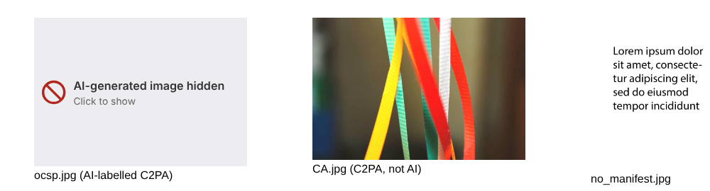

# Block AI Content

A Chrome extension that hides images labelled as AI-generated, including on
Facebook, Instagram and Threads. (Also works in Edge, Brave, Arc and other
Chromium browsers. Android is [experimental](INSTALL.md#android-experimental); iOS Safari is
[tracked here](https://github.com/radiosilence/block-ai-content/issues/1).)

**Just want to install it? → [Installation guide](INSTALL.md)** (no technical knowledge needed)

**Already installed? → [Test page](https://radiosilence.github.io/block-ai-content/)** tells you if it's working.



## How it works

There's no reliable way to look at an image and tell whether AI made it. AI
detectors are bad at it and getting worse. What _does_ work is reading the
labels AI vendors put inside the file:

| Signal                                                                                          | What it is                                                                                                                              | Who writes it                                                                                   |
| ----------------------------------------------------------------------------------------------- | --------------------------------------------------------------------------------------------------------------------------------------- | ----------------------------------------------------------------------------------------------- |
| **IPTC digital source type** `trainedAlgorithmicMedia` / `compositeWithTrainedAlgorithmicMedia` | The standard vocabulary for "a model made this (or part of it)", in XMP metadata or inside a C2PA manifest                              | OpenAI, Adobe Firefly, Google, Microsoft, Meta, …                                               |
| **C2PA Content Credentials**                                                                    | A signed provenance record embedded in the file (JPEG APP11, PNG `caBX`, WebP `C2PA`)                                                   | Same, plus cameras and editing tools (which aren't AI, so C2PA alone isn't treated as a signal) |
| **Generator leftovers** _(optional, on by default)_                                             | Stable Diffusion `parameters`, ComfyUI `prompt`/`workflow`, InvokeAI metadata in PNG text chunks; Google's "Made with Google AI" credit | Local image-generation tools                                                                    |

The EU AI Act (Article 50(2)) requires providers of generative AI systems to
mark their output in a machine-readable, detectable way. Under the Digital
Omnibus amendments the marking duty applies from **2 December 2026**, and the
Commission's transparency Code of Practice names C2PA-style provenance metadata
and invisible watermarks as the ways to do it. This extension reads the
metadata half of that.

### What it can't do

- **Invisible watermarks** (Google SynthID, Meta Video Seal, etc.) need the
  vendor's proprietary detector. They can't be checked in the browser.
- **Stripped metadata.** Most social platforms and many CDNs strip metadata on
  upload, taking the label with it. A screenshot removes it too. The Act puts
  the duty on the AI provider, not on every site that reposts the image.
- **Text.** AI text watermarking isn't deployed in any detectable form, and
  statistical "AI text detectors" have false positive rates that make them
  unfit for purpose.
- **Video and audio files** aren't inspected for embedded labels yet (C2PA supports them; contributions welcome). Videos _are_ hidden on Meta sites via the post label.
- **CSS background images** aren't inspected, only `` elements.

So: a false positive is very unlikely (the file has to say it's AI), but plenty
of AI content will get through.

### Facebook, Instagram and Threads

Meta re-encodes uploads and strips their metadata, so the file check above sees
nothing there. But Meta reads the IPTC/C2PA labels _at upload_ and shows an
**"AI info"** label on the post. On those sites the extension finds that label
and hides the images and videos in its post:

- The label is matched by its exact text (or `aria-label`), never by class names,
  which Meta regenerates constantly. A post that merely _mentions_ "AI info" in
  a sentence doesn't count.
- The post is the label's nearest `role="article"` / `<article>` /
  `aria-posinset` / feed-unit / dialog ancestor. Failing those, it's the nearest
  ancestor holding media, but never one containing the whole feed.
- Media drawn smaller than 100px (avatars, icons) is left alone.
- Media added to a flagged post later (carousels, lazy loading) is hidden too.
  If React reuses the post's container for a different post, the hidden media
  is shown again.
- **English UI only** for now; other languages show translated label text.
- **Tested against Facebook- and Instagram-shaped markup, not live Facebook**,
  which needs a logged-in account. If Meta changes the label's wording or
  structure this will need updating; please open an issue if it stops working.

It only catches what Meta catches, so unlabelled AI content still gets through.

## Architecture

```
src/
  detect/          Pure, browser-free detection. Unit tested.
    containers.ts  Pulls metadata out of JPEG / PNG / WebP (falls back to a whole-file scan for others)
    index.ts       Looks for AI labels in that metadata
    bytes.ts       Byte-level helpers
  platforms/
    meta.ts        Finds Meta's "AI info" labels and the post/media they belong to. Unit tested.
  background.ts    Service worker: fetches image bytes (bypassing CORS), memoises results, badge count
  content.ts       Finds s near the viewport, asks the worker about each, marks the AI ones;
                   on Meta sites also watches for "AI info" labels
  settings.ts      chrome.storage.sync-backed settings
  ui/              Popup and options page
static/            manifest.json, HTML, CSS
site/              The GitHub Pages test page (deployed by CI from main)
scripts/           esbuild build, icon generator, release packager
tests/             Vitest unit tests: real signed files from the C2PA reference SDK, and
                   Facebook/Instagram-shaped markup (jsdom)
  e2e/             Playwright tests that load the built extension into real Chromium
```

Images are inspected as they approach the viewport (1500px margin), skipping
anything under 48px. Chrome partitions its HTTP cache by site, so the service
worker usually has to download each image again. To keep that cheap:

- It asks for only the **first 256 KB** (`Range: bytes=0-262143`). That holds
  all of a JPEG's metadata, and the parser can tell when it has seen the lot.
  It only fetches the rest when the metadata runs on (PNG, WebP, big
  manifests), or when the server ignores `Range`.
- Requests are cookie-less, at most 6 at a time, capped at 25 MB.
- Verdicts are cached per URL in memory and in `chrome.storage.session`, so
  they survive Chrome stopping the idle worker. Failures aren't cached, so a
  network blip gets retried next time.

Hidden videos are paused, and kept paused through autoplay until revealed.
After an extension update, tabs that were already open stop quietly rather
than erroring on every image; they pick up the new version on refresh.

Styling is entirely in `static/content.css`, keyed off `data-aiblock` attributes.
"Hide" keeps the element's box (so the page doesn't reflow) and paints a
placeholder by pushing the image out with `object-position`.

## Development

Tooling is [mise](https://mise.jdx.dev) (pins Node and aube), [aube](https://github.com/aubepkg/aube)
(package manager), and [oxc](https://oxc.rs) (`oxlint` + `oxfmt`).

```sh
mise install        # Node 24 LTS + aube, from mise.toml
aube install
aube run build      # → dist/
aube run watch      # rebuild on change
aube run lint       # oxlint + oxfmt --check (aube run format to fix)
aube run typecheck
aube run test       # unit tests
aube run e2e        # browser tests against dist/ (needs a build first)
aube run check      # all of the above, in order: what CI runs
```

The browser tests need Playwright's Chromium: `aube exec playwright install chromium`.

Load `dist/` via **chrome://extensions → Developer mode → Load unpacked**, and
hit the reload icon on the extension card after rebuilding.

### CI/CD and releasing

`.github/workflows/ci-cd.yml` sets up the same toolchain with `jdx/mise-action`, then runs `aube run check` on every push and pull
request, then packages the extension (downloadable from the run as an
artifact). If the browser tests fail, their traces are uploaded too.

To release, bump `version` in `package.json` (the manifest takes its version
from there) and push to `main`. Once the check passes, the release job sees
there's no release for that version yet and publishes e.g. `v0.3.0` with
`block-ai-content-0.3.0.zip` attached, which is what [INSTALL.md](INSTALL.md)
points people at. Pushes that don't change the version don't release.

## Licence

MIT. Test fixtures in `tests/fixtures` are from
[c2pa-rs](https://github.com/contentauth/c2pa-rs) (MIT/Apache-2.0).
